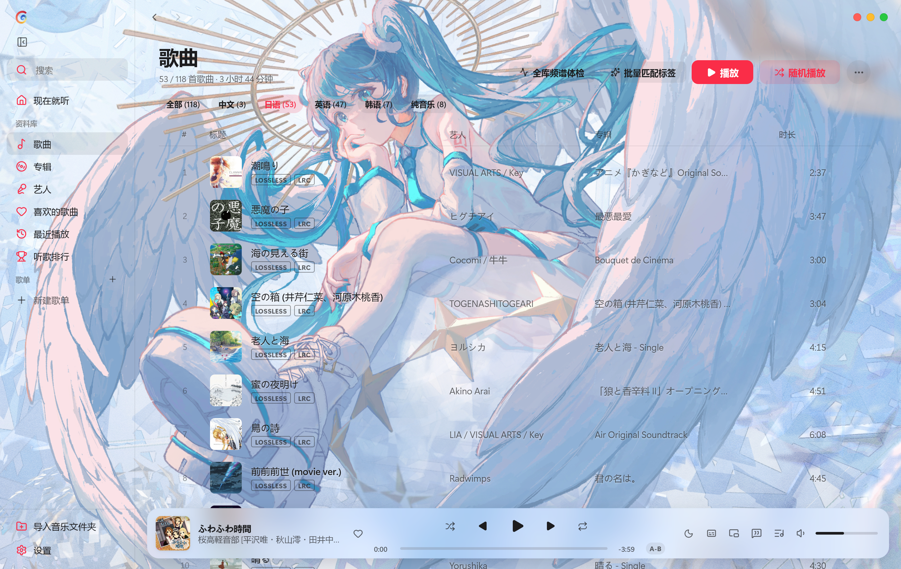
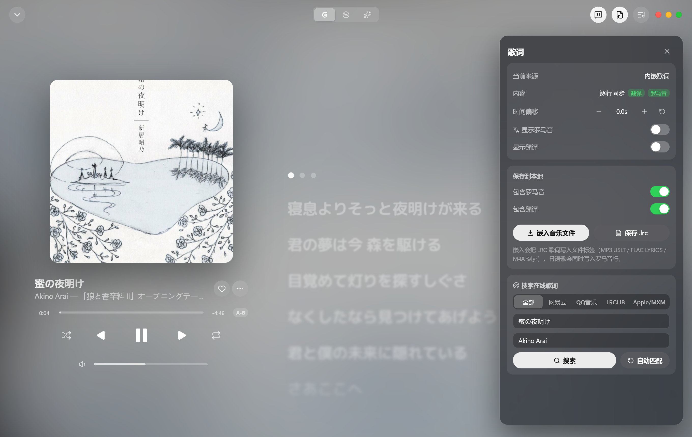
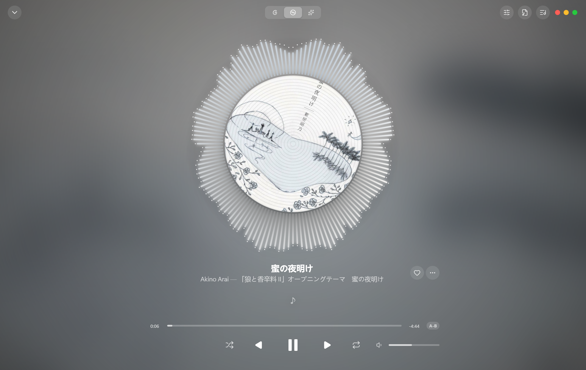
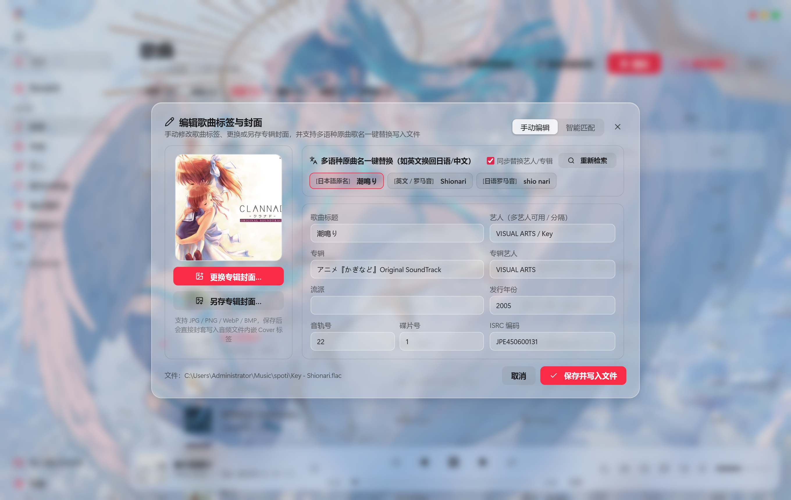
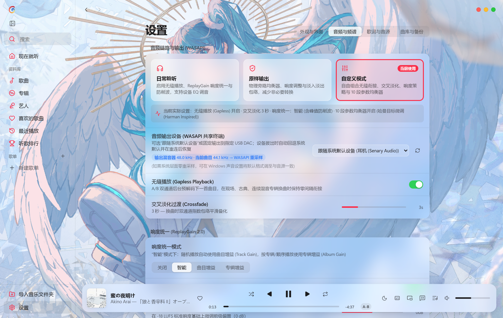

<div align="center">
  
  <h1>Kaze</h1>
  <p><strong>纯净 · 灵动 · 沉浸式的 Windows 本地高解析度音乐播放器</strong></p>
  <p>
    <a href="https://github.com/Akumy-01/Kaze/releases/latest">
      
    </a>
    
    
    
  </p>
</div>

---

## ✨ 界面预览

<table>
  <tr>
    <td width="50%">
      
      <p align="center"><b>主页概览</b> · 毛玻璃材质、自定义背景壁纸与曲库统计</p>
    </td>
    <td width="50%">
      
      <p align="center"><b>曲库管理</b> · 智能语种/纯音乐分类、LOSSLESS / LRC 徽章与即时封面加载</p>
    </td>
  </tr>
  <tr>
    <td width="50%">
      
      <p align="center"><b>灵动歌词</b> · 流体封面背景、逐行/逐字歌词、罗马音注音与多源匹配抽屉</p>
    </td>
    <td width="50%">
      
      <p align="center"><b>黑胶唱片</b> · 旋转黑胶、60fps 环形音频频谱与 A-B 区间循环</p>
    </td>
  </tr>
  <tr>
    <td width="50%">
      
      <p align="center"><b>标签与封面编辑</b> · 直接修改音频元数据、替换/另存封面、多语种歌名一键切换</p>
    </td>
    <td width="50%">
      
      <p align="center"><b>音频与频谱</b> · 10 段参数均衡器 (PEQ)、ReplayGain 2.0、无缝淡接与真假无损体检</p>
    </td>
  </tr>
</table>

---

## 🎵 核心特性

### 🎨 灵动视觉与玻璃拟态界面
- **多层毛玻璃与物理动效**：侧边栏自然推拉与淡入淡出动效、悬浮药丸式控制栏、Framer Motion 物理弹簧交互。
- **自定义背景**：支持默认主题、主题色渐变、自定义图片壁纸（可调高斯模糊与遮罩浓度），或随当前播放专辑封面动态流光。
- **窗口定制**：支持「经典圆点」与「Windows 风格」窗口控制按钮，支持深色 / 浅色 / 跟随系统，提供迷你播放器悬浮窗与透明亚克力优化。

### 🎧 高解析度本地音频管线
- **全格式兼容与稳定解码**：支持 FLAC、WAV、ALAC、APE、MP3、AAC/M4A、OGG、Opus 等格式，采用主进程本地 HTTP 回环流式输出 + Range 寻址，杜绝大文件高码率播至中途中断。
- **发烧级音频处理 (DSP)**：
  - **10 段参数均衡器 (PEQ)**：支持日常聆听、原样输出与自定义频段调节。
  - **ReplayGain 2.0 响度均衡** 与 **前置放大 / 限幅保护**。
  - **无缝衔接 (Gapless)**、**交叉淡入淡出 (Crossfade)** 与 **A-B 区间循环**。
- **真假无损频谱体检**：基于 FFT 高频截止分析本地音频文件，自动识别「真无损 (True Lossless)」与「升频假无损 / 有损压缩」。

### 📝 多源智能歌词 & 独立桌面悬浮歌词
- **四源并行检索与智能打分**：内置 **网易云音乐 / QQ 音乐 / LRCLIB / Apple Music & Musixmatch**，按分源标签缓存搜索结果，支持全自动匹配或手动挑选候选。
- **罗马音与翻译支持**：集成离线 `Kuroshiro + Kuromoji` 日文分词注音引擎，支持逐字/逐行歌词、翻译切换、时间轴微调（±0.1s / ±0.5s），并可一键**嵌入音频文件标签**或导出同名 `.lrc`。
- **独立桌面歌词窗口**：高帧率流畅渲染的独立透明桌面歌词窗口，支持单行/双行/三行显示、渐进扫光、字号/字体/配色自定义、位置锁定与鼠标穿透。

### 🗂️ 曲库管理、标签编辑器与贴心细节
- **智能分类**：精准区分 **中文 / 日语 / 英语 / 韩语 / 纯音乐**，过滤翻唱与混合标签干扰。
- **标签与封面编辑器**：支持直接编辑曲名、艺人、专辑、年份、音轨号并回写音频文件，支持从本地/在线替换专辑封面、高清封面另存，以及**多语种歌名一键切换**（如将英文译名切回日语/中文原名）。
- **听歌统计与实用工具**：最近播放、最常播放排行、定时睡眠关闭（按时间或播完当前曲目停止）、可拖动进度的迷你播放器，以及完整配置 `.js` 导出/导入备份。

---

## 📦 下载与安装

前往 [GitHub Releases](https://github.com/Akumy-01/Kaze/releases/latest) 下载最新的 Windows 安装包：
- `Kaze-Setup-<version>.exe`（Windows x64 NSIS 安装程序，支持自定义安装目录）

---

## ⌨️ 常用快捷键

| 快捷键 | 功能 |
| :--- | :--- |
| `Space` | 播放 / 暂停 |
| `←` / `→` | 快退 / 快进 5 秒 |
| `Ctrl + ←` / `Ctrl + →` | 上一首 / 下一首 |
| `↑` / `↓` | 音量调节 |
| `Ctrl + F` | 快速搜索曲库 |
| `Esc` | 退出当前播放舞台 |

---

## 🛠️ 本地开发与打包

```bash
# 1. 安装依赖
npm install

# 2. 启动开发环境（支持热更新）
npm run dev

# 3. 类型检查与生产构建
npm run typecheck
npm run build

# 4. 打包 Windows x64 安装包（输出至 dist/）
npm run dist
```

---

<div align="center">
  <sub>Built with Electron, React 19, TypeScript &amp; Web Audio API · MIT © Kaze</sub>
</div>
